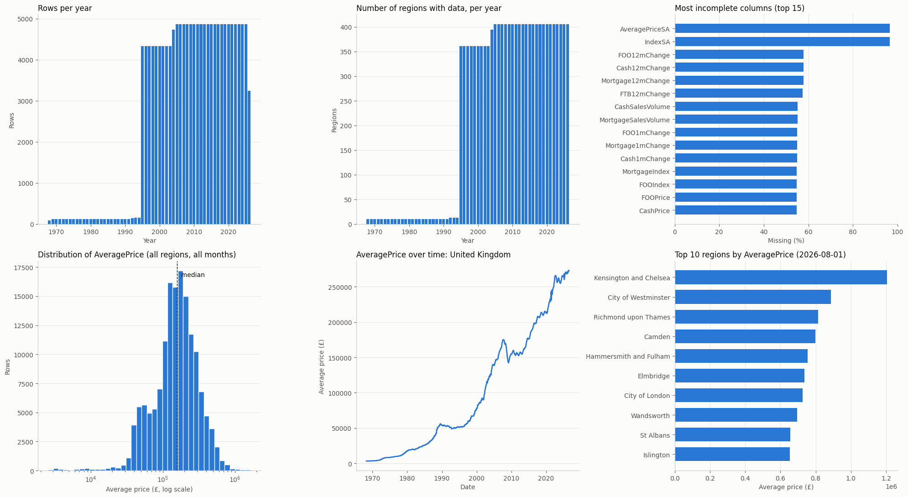

# UK House Price Index

This project looks at the following research questions using UK House Price Index (UK HPI) data:
1. Interest-Rate x Price Sensitivity Analysis
2. Linear Regression How is monthly house-price growth associated with changes in sales volume across UK 
3. Which UK regions had the most volatile monthly house-price changes over a user-selected period?
4. Within a region, which property types (detached, semi-detached, terraced, flat) were most affected?

The main data source is [UK HPI full file (Aug 2026)](https://publicdata.landregistry.gov.uk/market-trend-data/house-price-index-data/UK-HPI-full-file-2026-08.csv?utm_medium=GOV.UK&utm_source=datadownload&utm_campaign=full_fil&utm_term=9.30_21_10_26), published by HM Land Registry.

All four UK countries only have data since January 2005, where Northern Ireland's series began [(Source: Data Introduction)](https://www.gov.uk/government/publications/about-the-uk-house-price-index/about-the-uk-house-price-index#introduction). The analysis therefore starts from January 2025.


> **Note:** This notebook doubles as the project's GitHub README and covers the first steps of the exploratory data analysis (EDA).

# 1. Setup: Libraries and Load Data


```python
####### Import Library
import statistics
import numpy as np
import matplotlib.pyplot as plt
from scipy import stats
```

We start by looking at the columns in the UK House Price Index dataset. Full column definitions are in [Section 8 of About the UK House Price Index](https://www.gov.uk/government/publications/about-the-uk-house-price-index/about-the-uk-house-price-index).

| Column Header | Explanation |
|---|---|
| Date | The year and month to which the monthly statistics apply |
| RegionName | Name of geography (Country, Regional, County/Unitary/District Authority and London Borough) |
| AreaCode | Code of geography (Country, Regional, County/Unitary/District Authority and London Borough); E England, W Wales, S Scotland, N Northern Ireland, K UK-wide |
| Average Price | Average house price for a geography in a particular period |
| Index | House price index for a geography in a particular period (January 2023=100) |
| IndexSA | Seasonally adjusted house price for a geography in a particular period (January 2023=100) |
| 1m%change | The percentage change in the Average Price compared to the previous month |
| 12m%change | The percentage change in the Average Price compared to the same period twelve months earlier |
| AveragePricesSA | Seasonally adjusted Average Price for a geography in a particular period |
| Sales Volume | Number of registered transactions for a geography in a particular period |
| [Property Type]Price | Average house price for a particular property type (such as detached houses), for a geography in a particular period |
| [Property Type]Index | House price index for a particular property type (such as detached houses), for a geography in a particular period (January 2023=100) |
| [Property Type]1m%change | The percentage change in the [Property Type] Price compared to the previous month |
| [Property Type]12m%change | The percentage change in the [Property Type] Price compared to the same period twelve months earlier |
| [Cash/Mortgage]Price | Average house price by funding status (such as cash), for a geography in a particular period |
| [Cash/Mortgage]Index | House price index by funding status (such as cash), for a geography in a particular period (January 2023=100) |
| [Cash/Mortgage]1m%change | The percentage change in the [Cash/Mortgage]Price compared to the previous month |
| [Cash/Mortgage]12m%change | The percentage change in the [Cash/Mortgage]Price compared to the same period twelve months earlier |
| [Cash/Mortgage] Sales Volume | Number of registered transactions [Cash/Mortgage] for a geography in a particular period |
| [FTB/FOO]Price | Average house price by buyer status (such as first time buyer/former owner occupier), for a geography in a particular period |
| [FTB/FOO]Index | House price index by buyer status (such as first time buyer/former owner occupier), for a geography in a particular period (January 2023=100) |
| [FTB/FOO]1m%change | The percentage change in the [FTB/FOO]Price compared to the previous month |
| [FTB/FOO]12m%change | The percentage change in the [FTB/FOO]Price compared to the same period twelve months earlier |
| [New/Old]Price | Average house price by property status (such as new or existing property), for a geography in a particular period |
| [New/Old]Index | House price index by property status (such as new or existing property), for a geography in a particular period (January 2023=100) |
| [New/Old]1m%change | The percentage change in the [New/Old]Price compared to the previous month |
| [New/Old]12m%change | The percentage change in the [New/Old]Price compared to the same period twelve months earlier |
| [New/Old] Sales Volume | Number of registered transactions [New/Old] for a geography in a particular period |


```python
####### Load Data and Check Columns
file_path = "../uk_house_index_data_aug2026.csv"
columns = np.loadtxt(file_path, delimiter=",", dtype=str, max_rows=1)
print(columns)
```

    ['Date' 'RegionName' 'AreaCode' 'AveragePrice' 'Index' 'IndexSA'
     '1m%Change' '12m%Change' 'AveragePriceSA' 'SalesVolume' 'DetachedPrice'
     'DetachedIndex' 'Detached1m%Change' 'Detached12m%Change'
     'SemiDetachedPrice' 'SemiDetachedIndex' 'SemiDetached1m%Change'
     'SemiDetached12m%Change' 'TerracedPrice' 'TerracedIndex'
     'Terraced1m%Change' 'Terraced12m%Change' 'FlatPrice' 'FlatIndex'
     'Flat1m%Change' 'Flat12m%Change' 'CashPrice' 'CashIndex' 'Cash1m%Change'
     'Cash12m%Change' 'CashSalesVolume' 'MortgagePrice' 'MortgageIndex'
     'Mortgage1m%Change' 'Mortgage12m%Change' 'MortgageSalesVolume' 'FTBPrice'
     'FTBIndex' 'FTB1m%Change' 'FTB12m%Change' 'FOOPrice' 'FOOIndex'
     'FOO1m%Change' 'FOO12m%Change' 'NewPrice' 'NewIndex' 'New1m%Change'
     'New12m%Change' 'NewSalesVolume' 'OldPrice' 'OldIndex' 'Old1m%Change'
     'Old12m%Change' 'OldSalesVolume']


```python
####### Preview First 5 Rows
data = np.loadtxt(file_path, delimiter=",", dtype=str, skiprows = 1, max_rows=5)
print(data)
```

    [['01/01/2004' 'Aberdeenshire' 'S12000034' '84638' '41.1' '' '' '' ''
      '388' '130620' '43.2' '' '' '73972' '40.9' '' '' '58247' '38.8' '' ''
      '49322' '45.7' '' '' '' '' '' '' '' '' '' '' '' '' '' '' '' '' '' '' ''
      '' '112843' '40.7' '' '' '103' '81273' '41' '' '' '285']
     ['01/02/2004' 'Aberdeenshire' 'S12000034' '84623' '41.1' '' '0' '' ''
      '326' '129330' '42.7' '-1' '' '74225' '41.1' '0.3' '' '58669' '39.1'
      '0.7' '' '50364' '46.7' '2.1' '' '' '' '' '' '' '' '' '' '' '' '' '' ''
      '' '' '' '' '' '113061' '40.8' '0.2' '' '107' '81194' '40.9' '-0.1' ''
      '219']
     ['01/03/2004' 'Aberdeenshire' 'S12000034' '86536' '42.1' '' '2.3' '' ''
      '453' '131585' '43.5' '1.7' '' '76201' '42.2' '2.7' '' '60399' '40.2'
      '2.9' '' '51719' '47.9' '2.7' '' '' '' '' '' '' '' '' '' '' '' '' '' ''
      '' '' '' '' '' '115218' '41.6' '1.9' '' '140' '83137' '41.9' '2.4' ''
      '313']
     ['01/04/2004' 'Aberdeenshire' 'S12000034' '87373' '42.5' '' '1' '' ''
      '571' '130454' '43.1' '-0.9' '' '78082' '43.2' '2.5' '' '62326' '41.5'
      '3.2' '' '53143' '49.2' '2.8' '' '' '' '' '' '' '' '' '' '' '' '' '' ''
      '' '' '' '' '' '115247' '41.6' '0' '' '180' '84241' '42.5' '1.3' ''
      '391']
     ['01/05/2004' 'Aberdeenshire' 'S12000034' '89493' '43.5' '' '2.4' '' ''
      '502' '132762' '43.9' '1.8' '' '80340' '44.5' '2.9' '' '64442' '42.9'
      '3.4' '' '54678' '50.7' '2.9' '' '' '' '' '' '' '' '' '' '' '' '' '' ''
      '' '' '' '' '' '117377' '42.4' '1.8' '' '167' '86466' '43.6' '2.6' ''
      '335']]


```python
####### Specify types for each columns, and load data

types = []

for c in columns:
    if c == 'Date':
        types.append("datetime64[D]")
    elif c == "RegionName":
        types.append("U60") #UnicodeText up to 60 characters
    elif c == "AreaCode":
        types.append("U12") #UnicodeText up to 12 characters
    else:
        types.append("f8") #float, for all price, index, change and volume columns
    
data = np.genfromtxt(
    fname = file_path,
    delimiter = ",",
    dtype = types,
    names = True, # take first row as column names
    converters = {"Date": lambda s: np.datetime64(s[6:10] + "-" + s[3:5] + "-" + s[0:2])} #covert date to YYYY-MM-DD format
)

# Other Data Fixes
names = data.dtype.names
years = data["Date"].astype("datetime64[Y]").astype(int)+1970 # NumPy stores dates as an offset from 1970-01-01 (the Unix epoch)
year_list, year_counts = np.unique(years, return_counts = True) # Find unique elements of an array and return the number of times each unique item appears in ar.
```

# 2. Data Exploration (EDA) 

## Shape and Dates
We took the number of rows, columns and date range of the data


```python
 
print("=== OVERVIEW ===")
print("Rows         :", data.shape[0])
print("Columns      :", len(names))
print("Date range   :", data["Date"].min(), "to", data["Date"].max())
print("Years listed :", year_list.min(), "-", year_list.max(), f"({len(year_list)} years)")
print("Months listed:", len(np.unique(data["Date"])))
```

    === OVERVIEW ===
    Rows         : 152325
    Columns      : 54
    Date range   : 1968-04-01 to 2026-08-01
    Years listed : 1968 - 2026 (59 years)
    Months listed: 701


## Regions


```python
regions, region_counts = np.unique(data["RegionName"], return_counts=True)
country_map = {"E": "England", "W": "Wales", "S": "Scotland", "N": "Northern Ireland", "K": "UK / Great Britain level"}
prefix, prefix_counts = np.unique([c[0] for c in np.unique(data["AreaCode"])], return_counts=True)
 
print("\n=== REGIONS ===")
print("Unique regions:", len(regions))
print("Areas by code prefix:")
for p, n in zip(prefix, prefix_counts):
    print(f"  {p} ({country_map.get(p, 'other')}): {n}")
 
print("\nRegion | rows | first date | last date")
for r, n in zip(regions, region_counts):
    d = data["Date"][data["RegionName"] == r]
    print(f"  {r:<40} {n:>5}  {d.min()}  {d.max()}")
```

    
    === REGIONS ===
    Unique regions: 405
    Areas by code prefix:
      E (England): 334
      K (UK / Great Britain level): 3
      N (Northern Ireland): 12
      S (Scotland): 33
      W (Wales): 23
    
    Region | rows | first date | last date
      Aberdeenshire                              272  2004-01-01  2026-08-01
      Adur                                       380  1995-01-01  2026-08-01
      Amber Valley                               380  1995-01-01  2026-08-01
      Angus                                      272  2004-01-01  2026-08-01
      Antrim and Newtownabbey                    260  2005-01-01  2026-08-01
      Ards and North Down                        260  2005-01-01  2026-08-01
      Argyll and Bute                            272  2004-01-01  2026-08-01
      Armagh City Banbridge and Craigavon        260  2005-01-01  2026-08-01
      Arun                                       380  1995-01-01  2026-08-01
      Ashfield                                   380  1995-01-01  2026-08-01
      Ashford                                    380  1995-01-01  2026-08-01
      Babergh                                    380  1995-01-01  2026-08-01
      Barking and Dagenham                       380  1995-01-01  2026-08-01
      Barnet                                     380  1995-01-01  2026-08-01
      Barnsley                                   380  1995-01-01  2026-08-01
      Basildon                                   380  1995-01-01  2026-08-01
      Basingstoke and Deane                      380  1995-01-01  2026-08-01
      Bassetlaw                                  380  1995-01-01  2026-08-01
      Bath and North East Somerset               380  1995-01-01  2026-08-01
      Bedford                                    380  1995-01-01  2026-08-01
      Belfast                                    260  2005-01-01  2026-08-01
      Bexley                                     380  1995-01-01  2026-08-01
      Birmingham                                 380  1995-01-01  2026-08-01
      Blaby                                      380  1995-01-01  2026-08-01
      Blackburn with Darwen                      380  1995-01-01  2026-08-01
      Blackpool                                  380  1995-01-01  2026-08-01
      Blaenau Gwent                              380  1995-01-01  2026-08-01
      Bolsover                                   380  1995-01-01  2026-08-01
      Bolton                                     380  1995-01-01  2026-08-01
      Boston                                     380  1995-01-01  2026-08-01
      Bournemouth Christchurch and Poole         380  1995-01-01  2026-08-01
      Bracknell Forest                           380  1995-01-01  2026-08-01
      Bradford                                   380  1995-01-01  2026-08-01
      Braintree                                  380  1995-01-01  2026-08-01
      Breckland                                  380  1995-01-01  2026-08-01
      Brent                                      380  1995-01-01  2026-08-01
      Brentwood                                  380  1995-01-01  2026-08-01
      Bridgend                                   380  1995-01-01  2026-08-01
      Brighton and Hove                          380  1995-01-01  2026-08-01
      Broadland                                  380  1995-01-01  2026-08-01
      Bromley                                    380  1995-01-01  2026-08-01
      Bromsgrove                                 380  1995-01-01  2026-08-01
      Broxbourne                                 380  1995-01-01  2026-08-01
      Broxtowe                                   380  1995-01-01  2026-08-01
      Buckinghamshire                            380  1995-01-01  2026-08-01
      Burnley                                    380  1995-01-01  2026-08-01
      Bury                                       380  1995-01-01  2026-08-01
      Caerphilly                                 380  1995-01-01  2026-08-01
      Calderdale                                 380  1995-01-01  2026-08-01
      Cambridge                                  380  1995-01-01  2026-08-01
      Cambridgeshire                             380  1995-01-01  2026-08-01
      Camden                                     380  1995-01-01  2026-08-01
      Cannock Chase                              380  1995-01-01  2026-08-01
      Canterbury                                 380  1995-01-01  2026-08-01
      Cardiff                                    380  1995-01-01  2026-08-01
      Carmarthenshire                            380  1995-01-01  2026-08-01
      Castle Point                               380  1995-01-01  2026-08-01
      Causeway Coast and Glens                   260  2005-01-01  2026-08-01
      Central Bedfordshire                       380  1995-01-01  2026-08-01
      Ceredigion                                 380  1995-01-01  2026-08-01
      Charnwood                                  380  1995-01-01  2026-08-01
      Chelmsford                                 380  1995-01-01  2026-08-01
      Cheltenham                                 380  1995-01-01  2026-08-01
      Cherwell                                   380  1995-01-01  2026-08-01
      Cheshire East                              380  1995-01-01  2026-08-01
      Cheshire West and Chester                  380  1995-01-01  2026-08-01
      Chesterfield                               380  1995-01-01  2026-08-01
      Chichester                                 380  1995-01-01  2026-08-01
      Chorley                                    380  1995-01-01  2026-08-01
      City of Aberdeen                           272  2004-01-01  2026-08-01
      City of Bristol                            380  1995-01-01  2026-08-01
      City of Derby                              380  1995-01-01  2026-08-01
      City of Dundee                             272  2004-01-01  2026-08-01
      City of Edinburgh                          272  2004-01-01  2026-08-01
      City of Glasgow                            272  2004-01-01  2026-08-01
      City of Kingston upon Hull                 380  1995-01-01  2026-08-01
      City of London                             380  1995-01-01  2026-08-01
      City of Nottingham                         380  1995-01-01  2026-08-01
      City of Peterborough                       380  1995-01-01  2026-08-01
      City of Plymouth                           380  1995-01-01  2026-08-01
      City of Westminster                        380  1995-01-01  2026-08-01
      Clackmannanshire                           272  2004-01-01  2026-08-01
      Colchester                                 380  1995-01-01  2026-08-01
      Conwy                                      380  1995-01-01  2026-08-01
      Cornwall                                   380  1995-01-01  2026-08-01
      Cotswold                                   380  1995-01-01  2026-08-01
      County Durham                              380  1995-01-01  2026-08-01
      Coventry                                   380  1995-01-01  2026-08-01
      Crawley                                    380  1995-01-01  2026-08-01
      Croydon                                    380  1995-01-01  2026-08-01
      Cumberland                                 380  1995-01-01  2026-08-01
      Dacorum                                    380  1995-01-01  2026-08-01
      Darlington                                 380  1995-01-01  2026-08-01
      Dartford                                   380  1995-01-01  2026-08-01
      Denbighshire                               380  1995-01-01  2026-08-01
      Derbyshire                                 380  1995-01-01  2026-08-01
      Derbyshire Dales                           380  1995-01-01  2026-08-01
      Derry City and Strabane                    260  2005-01-01  2026-08-01
      Devon                                      380  1995-01-01  2026-08-01
      Doncaster                                  380  1995-01-01  2026-08-01
      Dorset                                     380  1995-01-01  2026-08-01
      Dover                                      380  1995-01-01  2026-08-01
      Dudley                                     380  1995-01-01  2026-08-01
      Dumfries and Galloway                      272  2004-01-01  2026-08-01
      Ealing                                     380  1995-01-01  2026-08-01
      East Ayrshire                              272  2004-01-01  2026-08-01
      East Cambridgeshire                        380  1995-01-01  2026-08-01
      East Devon                                 380  1995-01-01  2026-08-01
      East Dunbartonshire                        272  2004-01-01  2026-08-01
      East Hampshire                             380  1995-01-01  2026-08-01
      East Hertfordshire                         380  1995-01-01  2026-08-01
      East Lindsey                               380  1995-01-01  2026-08-01
      East Lothian                               272  2004-01-01  2026-08-01
      East Midlands                              701  1968-04-01  2026-08-01
      East Renfrewshire                          272  2004-01-01  2026-08-01
      East Riding of Yorkshire                   380  1995-01-01  2026-08-01
      East Staffordshire                         380  1995-01-01  2026-08-01
      East Suffolk                               380  1995-01-01  2026-08-01
      East Sussex                                380  1995-01-01  2026-08-01
      East of England                            413  1992-04-01  2026-08-01
      Eastbourne                                 380  1995-01-01  2026-08-01
      Eastleigh                                  380  1995-01-01  2026-08-01
      Elmbridge                                  380  1995-01-01  2026-08-01
      Enfield                                    380  1995-01-01  2026-08-01
      England                                    701  1968-04-01  2026-08-01
      England and Wales                          380  1995-01-01  2026-08-01
      Epping Forest                              380  1995-01-01  2026-08-01
      Epsom and Ewell                            380  1995-01-01  2026-08-01
      Erewash                                    380  1995-01-01  2026-08-01
      Essex                                      380  1995-01-01  2026-08-01
      Exeter                                     380  1995-01-01  2026-08-01
      Falkirk                                    272  2004-01-01  2026-08-01
      Fareham                                    380  1995-01-01  2026-08-01
      Fenland                                    380  1995-01-01  2026-08-01
      Fermanagh and Omagh                        260  2005-01-01  2026-08-01
      Fife                                       272  2004-01-01  2026-08-01
      Flintshire                                 380  1995-01-01  2026-08-01
      Folkestone and Hythe                       380  1995-01-01  2026-08-01
      Forest of Dean                             380  1995-01-01  2026-08-01
      Fylde                                      380  1995-01-01  2026-08-01
      Gateshead                                  380  1995-01-01  2026-08-01
      Gedling                                    380  1995-01-01  2026-08-01
      Gloucester                                 380  1995-01-01  2026-08-01
      Gloucestershire                            380  1995-01-01  2026-08-01
      Gosport                                    380  1995-01-01  2026-08-01
      Gravesham                                  380  1995-01-01  2026-08-01
      Great Britain                              272  2004-01-01  2026-08-01
      Great Yarmouth                             380  1995-01-01  2026-08-01
      Greater Manchester                         380  1995-01-01  2026-08-01
      Greenwich                                  380  1995-01-01  2026-08-01
      Guildford                                  380  1995-01-01  2026-08-01
      Gwynedd                                    380  1995-01-01  2026-08-01
      Hackney                                    380  1995-01-01  2026-08-01
      Halton                                     380  1995-01-01  2026-08-01
      Hammersmith and Fulham                     380  1995-01-01  2026-08-01
      Hampshire                                  380  1995-01-01  2026-08-01
      Harborough                                 380  1995-01-01  2026-08-01
      Haringey                                   380  1995-01-01  2026-08-01
      Harlow                                     380  1995-01-01  2026-08-01
      Harrow                                     380  1995-01-01  2026-08-01
      Hart                                       380  1995-01-01  2026-08-01
      Hartlepool                                 380  1995-01-01  2026-08-01
      Hastings                                   380  1995-01-01  2026-08-01
      Havant                                     380  1995-01-01  2026-08-01
      Havering                                   380  1995-01-01  2026-08-01
      Herefordshire                              380  1995-01-01  2026-08-01
      Hertfordshire                              380  1995-01-01  2026-08-01
      Hertsmere                                  380  1995-01-01  2026-08-01
      High Peak                                  380  1995-01-01  2026-08-01
      Highland                                   272  2004-01-01  2026-08-01
      Hillingdon                                 380  1995-01-01  2026-08-01
      Hinckley and Bosworth                      380  1995-01-01  2026-08-01
      Horsham                                    380  1995-01-01  2026-08-01
      Hounslow                                   380  1995-01-01  2026-08-01
      Huntingdonshire                            380  1995-01-01  2026-08-01
      Hyndburn                                   380  1995-01-01  2026-08-01
      Inner London                               380  1995-01-01  2026-08-01
      Inverclyde                                 272  2004-01-01  2026-08-01
      Ipswich                                    380  1995-01-01  2026-08-01
      Isle of Anglesey                           380  1995-01-01  2026-08-01
      Isle of Wight                              380  1995-01-01  2026-08-01
      Islington                                  380  1995-01-01  2026-08-01
      Kensington and Chelsea                     380  1995-01-01  2026-08-01
      Kent                                       380  1995-01-01  2026-08-01
      King's Lynn and West Norfolk               380  1995-01-01  2026-08-01
      Kingston upon Thames                       380  1995-01-01  2026-08-01
      Kirklees                                   380  1995-01-01  2026-08-01
      Knowsley                                   380  1995-01-01  2026-08-01
      Lambeth                                    380  1995-01-01  2026-08-01
      Lancashire                                 380  1995-01-01  2026-08-01
      Lancaster                                  380  1995-01-01  2026-08-01
      Leeds                                      380  1995-01-01  2026-08-01
      Leicester                                  380  1995-01-01  2026-08-01
      Leicestershire                             380  1995-01-01  2026-08-01
      Lewes                                      380  1995-01-01  2026-08-01
      Lewisham                                   380  1995-01-01  2026-08-01
      Lichfield                                  380  1995-01-01  2026-08-01
      Lincoln                                    380  1995-01-01  2026-08-01
      Lincolnshire                               380  1995-01-01  2026-08-01
      Lisburn and Castlereagh                    260  2005-01-01  2026-08-01
      Liverpool                                  380  1995-01-01  2026-08-01
      London                                     701  1968-04-01  2026-08-01
      Luton                                      380  1995-01-01  2026-08-01
      Maidstone                                  380  1995-01-01  2026-08-01
      Maldon                                     380  1995-01-01  2026-08-01
      Malvern Hills                              380  1995-01-01  2026-08-01
      Manchester                                 380  1995-01-01  2026-08-01
      Mansfield                                  380  1995-01-01  2026-08-01
      Medway                                     380  1995-01-01  2026-08-01
      Melton                                     380  1995-01-01  2026-08-01
      Merseyside                                 380  1995-01-01  2026-08-01
      Merthyr Tydfil                             380  1995-01-01  2026-08-01
      Merton                                     380  1995-01-01  2026-08-01
      Mid Devon                                  380  1995-01-01  2026-08-01
      Mid Suffolk                                380  1995-01-01  2026-08-01
      Mid Sussex                                 380  1995-01-01  2026-08-01
      Mid Ulster                                 260  2005-01-01  2026-08-01
      Mid and East Antrim                        260  2005-01-01  2026-08-01
      Middlesbrough                              380  1995-01-01  2026-08-01
      Midlothian                                 272  2004-01-01  2026-08-01
      Milton Keynes                              380  1995-01-01  2026-08-01
      Mole Valley                                380  1995-01-01  2026-08-01
      Monmouthshire                              380  1995-01-01  2026-08-01
      Moray                                      272  2004-01-01  2026-08-01
      Na h-Eileanan Siar                         272  2004-01-01  2026-08-01
      Neath Port Talbot                          380  1995-01-01  2026-08-01
      New Forest                                 380  1995-01-01  2026-08-01
      Newark and Sherwood                        380  1995-01-01  2026-08-01
      Newcastle upon Tyne                        380  1995-01-01  2026-08-01
      Newcastle-under-Lyme                       380  1995-01-01  2026-08-01
      Newham                                     380  1995-01-01  2026-08-01
      Newport                                    380  1995-01-01  2026-08-01
      Newry Mourne and Down                      260  2005-01-01  2026-08-01
      Norfolk                                    380  1995-01-01  2026-08-01
      North Ayrshire                             272  2004-01-01  2026-08-01
      North Devon                                380  1995-01-01  2026-08-01
      North East                                 413  1992-04-01  2026-08-01
      North East Derbyshire                      380  1995-01-01  2026-08-01
      North East Lincolnshire                    380  1995-01-01  2026-08-01
      North Hertfordshire                        380  1995-01-01  2026-08-01
      North Kesteven                             380  1995-01-01  2026-08-01
      North Lanarkshire                          272  2004-01-01  2026-08-01
      North Lincolnshire                         380  1995-01-01  2026-08-01
      North Norfolk                              380  1995-01-01  2026-08-01
      North Northamptonshire                     380  1995-01-01  2026-08-01
      North Somerset                             380  1995-01-01  2026-08-01
      North Tyneside                             380  1995-01-01  2026-08-01
      North Warwickshire                         380  1995-01-01  2026-08-01
      North West                                 380  1995-01-01  2026-08-01
      North West Leicestershire                  380  1995-01-01  2026-08-01
      North Yorkshire                            380  1995-01-01  2026-08-01
      Northern Ireland                           701  1968-04-01  2026-08-01
      Northumberland                             380  1995-01-01  2026-08-01
      Norwich                                    380  1995-01-01  2026-08-01
      Nottinghamshire                            380  1995-01-01  2026-08-01
      Nuneaton and Bedworth                      380  1995-01-01  2026-08-01
      Oadby and Wigston                          380  1995-01-01  2026-08-01
      Oldham                                     380  1995-01-01  2026-08-01
      Orkney Islands                             272  2004-01-01  2026-08-01
      Outer London                               380  1995-01-01  2026-08-01
      Oxford                                     380  1995-01-01  2026-08-01
      Oxfordshire                                380  1995-01-01  2026-08-01
      Pembrokeshire                              380  1995-01-01  2026-08-01
      Pendle                                     380  1995-01-01  2026-08-01
      Perth and Kinross                          272  2004-01-01  2026-08-01
      Portsmouth                                 380  1995-01-01  2026-08-01
      Powys                                      380  1995-01-01  2026-08-01
      Preston                                    380  1995-01-01  2026-08-01
      Reading                                    380  1995-01-01  2026-08-01
      Redbridge                                  380  1995-01-01  2026-08-01
      Redcar and Cleveland                       380  1995-01-01  2026-08-01
      Redditch                                   380  1995-01-01  2026-08-01
      Reigate and Banstead                       380  1995-01-01  2026-08-01
      Renfrewshire                               272  2004-01-01  2026-08-01
      Rhondda Cynon Taf                          380  1995-01-01  2026-08-01
      Ribble Valley                              380  1995-01-01  2026-08-01
      Richmond upon Thames                       380  1995-01-01  2026-08-01
      Rochdale                                   380  1995-01-01  2026-08-01
      Rochford                                   380  1995-01-01  2026-08-01
      Rossendale                                 380  1995-01-01  2026-08-01
      Rother                                     380  1995-01-01  2026-08-01
      Rotherham                                  380  1995-01-01  2026-08-01
      Rugby                                      380  1995-01-01  2026-08-01
      Runnymede                                  380  1995-01-01  2026-08-01
      Rushcliffe                                 380  1995-01-01  2026-08-01
      Rushmoor                                   380  1995-01-01  2026-08-01
      Rutland                                    380  1995-01-01  2026-08-01
      Salford                                    380  1995-01-01  2026-08-01
      Sandwell                                   380  1995-01-01  2026-08-01
      Scotland                                   701  1968-04-01  2026-08-01
      Scottish Borders                           272  2004-01-01  2026-08-01
      Sefton                                     380  1995-01-01  2026-08-01
      Sevenoaks                                  380  1995-01-01  2026-08-01
      Sheffield                                  380  1995-01-01  2026-08-01
      Shetland Islands                           272  2004-01-01  2026-08-01
      Shropshire                                 380  1995-01-01  2026-08-01
      Slough                                     380  1995-01-01  2026-08-01
      Solihull                                   380  1995-01-01  2026-08-01
      Somerset                                   380  1995-01-01  2026-08-01
      South Ayrshire                             272  2004-01-01  2026-08-01
      South Cambridgeshire                       380  1995-01-01  2026-08-01
      South Derbyshire                           380  1995-01-01  2026-08-01
      South East                                 413  1992-04-01  2026-08-01
      South Gloucestershire                      380  1995-01-01  2026-08-01
      South Hams                                 380  1995-01-01  2026-08-01
      South Holland                              380  1995-01-01  2026-08-01
      South Kesteven                             380  1995-01-01  2026-08-01
      South Lanarkshire                          272  2004-01-01  2026-08-01
      South Norfolk                              380  1995-01-01  2026-08-01
      South Oxfordshire                          380  1995-01-01  2026-08-01
      South Ribble                               380  1995-01-01  2026-08-01
      South Staffordshire                        380  1995-01-01  2026-08-01
      South Tyneside                             380  1995-01-01  2026-08-01
      South West                                 701  1968-04-01  2026-08-01
      South Yorkshire                            380  1995-01-01  2026-08-01
      Southampton                                380  1995-01-01  2026-08-01
      Southend-on-Sea                            380  1995-01-01  2026-08-01
      Southwark                                  380  1995-01-01  2026-08-01
      Spelthorne                                 380  1995-01-01  2026-08-01
      St Albans                                  380  1995-01-01  2026-08-01
      St Helens                                  380  1995-01-01  2026-08-01
      Stafford                                   380  1995-01-01  2026-08-01
      Staffordshire                              380  1995-01-01  2026-08-01
      Staffordshire Moorlands                    380  1995-01-01  2026-08-01
      Stevenage                                  380  1995-01-01  2026-08-01
      Stirling                                   272  2004-01-01  2026-08-01
      Stockport                                  380  1995-01-01  2026-08-01
      Stockton-on-Tees                           380  1995-01-01  2026-08-01
      Stoke-on-Trent                             380  1995-01-01  2026-08-01
      Stratford-on-Avon                          380  1995-01-01  2026-08-01
      Stroud                                     380  1995-01-01  2026-08-01
      Suffolk                                    380  1995-01-01  2026-08-01
      Sunderland                                 380  1995-01-01  2026-08-01
      Surrey                                     380  1995-01-01  2026-08-01
      Surrey Heath                               380  1995-01-01  2026-08-01
      Sutton                                     380  1995-01-01  2026-08-01
      Swale                                      380  1995-01-01  2026-08-01
      Swansea                                    380  1995-01-01  2026-08-01
      Swindon                                    380  1995-01-01  2026-08-01
      Tameside                                   380  1995-01-01  2026-08-01
      Tamworth                                   380  1995-01-01  2026-08-01
      Tandridge                                  380  1995-01-01  2026-08-01
      Teignbridge                                380  1995-01-01  2026-08-01
      Telford and Wrekin                         380  1995-01-01  2026-08-01
      Tendring                                   380  1995-01-01  2026-08-01
      Test Valley                                380  1995-01-01  2026-08-01
      Tewkesbury                                 380  1995-01-01  2026-08-01
      Thanet                                     380  1995-01-01  2026-08-01
      Three Rivers                               380  1995-01-01  2026-08-01
      Thurrock                                   380  1995-01-01  2026-08-01
      Tonbridge and Malling                      380  1995-01-01  2026-08-01
      Torbay                                     380  1995-01-01  2026-08-01
      Torfaen                                    380  1995-01-01  2026-08-01
      Torridge                                   380  1995-01-01  2026-08-01
      Tower Hamlets                              380  1995-01-01  2026-08-01
      Trafford                                   380  1995-01-01  2026-08-01
      Tunbridge Wells                            380  1995-01-01  2026-08-01
      Tyne and Wear                              380  1995-01-01  2026-08-01
      United Kingdom                             701  1968-04-01  2026-08-01
      Uttlesford                                 380  1995-01-01  2026-08-01
      Vale of Glamorgan                          380  1995-01-01  2026-08-01
      Vale of White Horse                        380  1995-01-01  2026-08-01
      Wakefield                                  380  1995-01-01  2026-08-01
      Wales                                      701  1968-04-01  2026-08-01
      Walsall                                    380  1995-01-01  2026-08-01
      Waltham Forest                             380  1995-01-01  2026-08-01
      Wandsworth                                 380  1995-01-01  2026-08-01
      Warrington                                 380  1995-01-01  2026-08-01
      Warwick                                    380  1995-01-01  2026-08-01
      Warwickshire                               380  1995-01-01  2026-08-01
      Watford                                    380  1995-01-01  2026-08-01
      Waverley                                   380  1995-01-01  2026-08-01
      Wealden                                    380  1995-01-01  2026-08-01
      Welwyn Hatfield                            380  1995-01-01  2026-08-01
      West Berkshire                             380  1995-01-01  2026-08-01
      West Devon                                 380  1995-01-01  2026-08-01
      West Dunbartonshire                        272  2004-01-01  2026-08-01
      West Lancashire                            380  1995-01-01  2026-08-01
      West Lindsey                               380  1995-01-01  2026-08-01
      West Lothian                               272  2004-01-01  2026-08-01
      West Midlands                              380  1995-01-01  2026-08-01
      West Midlands Region                       701  1968-04-01  2026-08-01
      West Northamptonshire                      380  1995-01-01  2026-08-01
      West Oxfordshire                           380  1995-01-01  2026-08-01
      West Suffolk                               380  1995-01-01  2026-08-01
      West Sussex                                380  1995-01-01  2026-08-01
      West Yorkshire                             380  1995-01-01  2026-08-01
      Westmorland and Furness                    380  1995-01-01  2026-08-01
      Wigan                                      380  1995-01-01  2026-08-01
      Wiltshire                                  380  1995-01-01  2026-08-01
      Winchester                                 380  1995-01-01  2026-08-01
      Windsor and Maidenhead                     380  1995-01-01  2026-08-01
      Wirral                                     380  1995-01-01  2026-08-01
      Woking                                     380  1995-01-01  2026-08-01
      Wokingham                                  380  1995-01-01  2026-08-01
      Wolverhampton                              380  1995-01-01  2026-08-01
      Worcester                                  380  1995-01-01  2026-08-01
      Worcestershire                             380  1995-01-01  2026-08-01
      Worthing                                   380  1995-01-01  2026-08-01
      Wrexham                                    380  1995-01-01  2026-08-01
      Wychavon                                   380  1995-01-01  2026-08-01
      Wyre                                       380  1995-01-01  2026-08-01
      Wyre Forest                                380  1995-01-01  2026-08-01
      York                                       380  1995-01-01  2026-08-01
      Yorkshire and The Humber                   701  1968-04-01  2026-08-01


## Missing Values


```python
missing_pct = np.array([np.isnan(data[c]).mean() * 100 for c in num_cols])
order = np.argsort(missing_pct)[::-1]
 
print("\n=== MISSING VALUES (%) ===")
for i in order:
    print(f"  {num_cols[i]:<24} {missing_pct[i]:6.1f}%")
 
```

    
    === MISSING VALUES (%) ===
      AveragePriceSA             96.5%
      IndexSA                    96.5%
      FOO12mChange               57.8%
      Cash12mChange              57.8%
      Mortgage12mChange          57.8%
      FTB12mChange               57.5%
      CashSalesVolume            55.2%
      MortgageSalesVolume        55.2%
      FOO1mChange                55.0%
      Mortgage1mChange           55.0%
      Cash1mChange               55.0%
      MortgageIndex              54.7%
      FOOIndex                   54.7%
      FOOPrice                   54.7%
      CashPrice                  54.7%
      CashIndex                  54.7%
      MortgagePrice              54.7%
      FTB1mChange                54.7%
      FTBPrice                   54.4%
      FTBIndex                   54.4%
      New12mChange                8.0%
      Old12mChange                7.9%
      SemiDetached12mChange       7.6%
      Detached12mChange           7.6%
      Terraced12mChange           7.6%
      NewSalesVolume              7.5%
      Flat12mChange               7.4%
      New1mChange                 5.2%
      Old1mChange                 5.1%
      NewPrice                    4.9%
      NewIndex                    4.9%
      OldSalesVolume              4.8%
      OldPrice                    4.8%
      OldIndex                    4.8%
      Detached1mChange            4.8%
      SemiDetached1mChange        4.8%
      Terraced1mChange            4.7%
      Flat1mChange                4.5%
      SemiDetachedPrice           4.5%
      DetachedPrice               4.5%
      DetachedIndex               4.5%
      SemiDetachedIndex           4.5%
      TerracedIndex               4.5%
      TerracedPrice               4.5%
      FlatIndex                   4.3%
      FlatPrice                   4.3%
      12mChange                   3.2%
      SalesVolume                 2.9%
      1mChange                    0.3%
      Index                       0.0%
      AveragePrice                0.0%


## Descriptive Statistics


```python
key_cols = [c for c in ("AveragePrice", "Index", "1mChange", "12mChange", "SalesVolume",
                        "DetachedPrice", "SemiDetachedPrice", "TerracedPrice", "FlatPrice") if c in names]
 
print("\n=== DESCRIPTIVE STATISTICS ===")
print(f"{'column':<20}{'n':>8}{'mean':>14}{'median':>14}{'stdev':>14}{'min':>14}{'max':>14}{'skew':>8}{'kurt':>8}")
for c in key_cols:
    x = data[c][~np.isnan(data[c])]
    if len(x) < 2:
        continue
    v = x.tolist()
    print(f"{c:<20}{len(v):>8}{statistics.mean(v):>14.2f}{statistics.median(v):>14.2f}"
          f"{statistics.stdev(v):>14.2f}{min(v):>14.2f}{max(v):>14.2f}"
          f"{stats.skew(x):>8.2f}{stats.kurtosis(x):>8.2f}")
```

    
    === DESCRIPTIVE STATISTICS ===
    column                     n          mean        median         stdev           min           max    skew    kurt
    AveragePrice          152325     185712.96     157087.00     132608.36       2553.00    1656986.00    2.42   12.26
    Index                 152325         60.73         61.60         27.04          0.80        153.10   -0.15   -0.91
    1mChange              151872          0.52          0.50          1.92        -30.30         35.30    0.59   11.84
    12mChange             147465          6.00          5.00          8.57        -35.80         98.40    0.75    2.87
    SalesVolume           147858       1251.70        214.00       7700.68          2.00     183609.00   11.40  143.17
    DetachedPrice         145428     346991.64     264161.50     347282.96      40117.00    5820174.00    5.73   53.83
    SemiDetachedPrice     145428     213336.91     162969.00     225058.93      24973.00    3919683.00    6.46   66.49
    TerracedPrice         145539     171031.81     130648.00     187698.76      19407.00    3888915.00    7.28   86.01
    FlatPrice             145808     122542.30     100863.00      97974.72      15712.00    1330583.00    3.85   25.92


# 3. Overview Charts


```python
BLUE, BG, INK, MUTED, GRID = "#2a78d6", "#fcfcfb", "#0b0b0b", "#52514e", "#e5e4e0"
 
def style(ax, title, xlabel, ylabel, grid_axis="y"):
    ax.set_facecolor(BG)
    ax.set_title(title, loc="left", color=INK, fontsize=12)
    ax.set_xlabel(xlabel, color=MUTED)
    ax.set_ylabel(ylabel, color=MUTED)
    ax.tick_params(colors=MUTED)
    ax.spines[["top", "right"]].set_visible(False)
    ax.spines[["left", "bottom"]].set_color("#c8c7c1")
    ax.grid(axis=grid_axis, color=GRID, linewidth=0.8)
    ax.set_axisbelow(True)
 
fig, axes = plt.subplots(2, 3, figsize=(20, 11), facecolor=BG)
 
# a) Rows per year
ax = axes[0, 0]
ax.bar(year_list, year_counts, width=0.8, color=BLUE)
style(ax, "Rows per year", "Year", "Rows")

# b) Regions reporting per year
ax = axes[0, 1]
regions_per_year = [len(np.unique(data["RegionName"][years == y])) for y in year_list]
ax.bar(year_list, regions_per_year, width=0.8, color=BLUE)
style(ax, "Number of regions with data, per year", "Year", "Regions")
 
# c) Missing values, top 15 columns
ax = axes[0, 2]
top = order[:15][::-1]
ax.barh([num_cols[i] for i in top], missing_pct[top], height=0.7, color=BLUE)
ax.set_xlim(0, 100)
style(ax, "Most incomplete columns (top 15)", "Missing (%)", "", grid_axis="x")
 
# d) Distribution of average price
ax = axes[1, 0]
price = data["AveragePrice"][~np.isnan(data["AveragePrice"])]
ax.hist(price, bins=np.logspace(np.log10(price.min()), np.log10(price.max()), 40),
        color=BLUE, edgecolor=BG, linewidth=1)
ax.set_xscale("log")
ax.axvline(statistics.median(price.tolist()), color=INK, linewidth=1, linestyle="--")
ax.text(statistics.median(price.tolist()), ax.get_ylim()[1] * 0.95, "  median", color=INK, va="top")
style(ax, "Distribution of AveragePrice (all regions, all months)", "Average price (£, log scale)", "Rows")
 
# e) Average price over time for one headline region
ax = axes[1, 1]
headline = "United Kingdom" if "United Kingdom" in regions else regions[np.argmax(region_counts)]
m = data["RegionName"] == headline
o = np.argsort(data["Date"][m])
ax.plot(data["Date"][m][o], data["AveragePrice"][m][o], color=BLUE, linewidth=2)
style(ax, f"AveragePrice over time: {headline}", "Date", "Average price (£)")
 
# f) Top 10 regions by latest average price
ax = axes[1, 2]
latest = data[data["Date"] == data["Date"].max()]
latest = latest[~np.isnan(latest["AveragePrice"])]
top10 = latest[np.argsort(latest["AveragePrice"])[-10:]]
ax.barh(top10["RegionName"], top10["AveragePrice"], height=0.7, color=BLUE)
style(ax, f"Top 10 regions by AveragePrice ({data['Date'].max()})", "Average price (£)", "", grid_axis="x")
 
plt.tight_layout()
plt.show()
 
```


    

    


# 4. Mortgage Rates - IUMBV34

IUMBV34 data represents the monthly average quoted interest rate for a 2-year fixed-rate mortgage at 75% loan-to-value (LTV)


```python
file_path_iumbv34 = "../IUMBV34.csv"
file_path_iumbv42 = "../IUMBV42.csv"

iumbv34 = np.genfromtxt(
    fname = file_path_iumbv34,
    delimiter = ",",
    dtype = None,
    skip_header = 1,
    names = ["Date","Rate2y"],
    encoding = "utf-8"
)


# print(iumbv34[:5])
# print(iumbv42[:)
months = {
    "Jan": "01", "Feb": "02", "Mar": "03",
    "Apr": "04", "May": "05", "Jun": "06",
    "Jul": "07", "Aug": "08", "Sep": "09",
    "Oct": "10", "Nov": "11", "Dec": "12"
}
formatted_dates = []

for d in iumbv34["Date"]:
    parts = d.split()
    day = parts[0]
    month = months[parts[1]]
    year = parts[2]

    new_date = f"{year}-{month}-{day}"
    formatted_dates.append(new_date)

formatted_dates = np.array(formatted_dates, dtype="datetime64[D]")

# Create a new array with the correct data types
iumbv34_clean = np.empty(
    len(iumbv34),
    dtype=[
        ("Date", "datetime64[D]"),
        ("Rate2y", "f8")
    ]
)

# Assign the values
iumbv34_clean["Date"] = formatted_dates
iumbv34_clean["Rate2y"] = iumbv34["Rate2y"]

# Replace the original array
iumbv34 = iumbv34_clean


print("=== OVERVIEW IUMBV34 ===")
print("Rows         :", iumbv34.shape[0])
print("Date range   :", iumbv34["Date"].min(), "to", iumbv34["Date"].max())

print("=== DATA PREVIEW ===")
print(iumbv34[:5])
```

    === OVERVIEW IUMBV34 ===
    Rows         : 380
    Date range   : 1995-01-31 to 2026-08-31
    === DATA PREVIEW ===
    [('1995-01-31', 8.13) ('1995-02-28', 8.38) ('1995-03-31', 8.08)
     ('1995-04-30', 8.29) ('1995-05-31', 8.22)]


```python
iumbv42 = np.genfromtxt(
    fname = file_path_iumbv42,
    delimiter = ",",
    dtype = None,
    skip_header = 1,
    names = ["Date", "Rate5y"],
    encoding = "utf-8"
)
# print(iumbv42[:5])

# since the data is all 2005 + 
def add_century(s):
    d,m,y = s.strip('"').split()
    return f"20{y}-{months[m]}-{d.zfill(2)}"

formatted_dates = []

for d in iumbv42["Date"]:
    formatted_dates.append(add_century(d))

# Create the clean structured array
iumbv42_clean = np.empty(
    iumbv42.shape[0],
    dtype = [("Date", "datetime64[D]"), ("Rate5y", "f8")]
)

# Assign the values
iumbv42_clean["Date"] = formatted_dates
iumbv42_clean["Rate5y"] = np.char.strip(iumbv42["Rate5y"], '"').astype(float)

# Replace the original array
iumbv42 = iumbv42_clean


print("=== OVERVIEW IUMBV42 ===")
print("Rows         :", iumbv42.shape[0])
print("Date range   :", iumbv42["Date"].min(), "to", iumbv42["Date"].max())

print("=== DATA PREVIEW ===")
print(iumbv42[:5])
```

    === OVERVIEW IUMBV42 ===
    Rows         : 262
    Date range   : 2005-01-31 to 2026-10-31
    === DATA PREVIEW ===
    [('2026-10-31', 5.19) ('2026-09-30', 4.98) ('2026-08-31', 4.78)
     ('2026-07-31', 4.58) ('2026-06-30', 4.62)]


```python
# Find the common dates and their positions in each array
common_dates, idx_rate2y, idx_rate5y = np.intersect1d(
    iumbv34["Date"], iumbv42["Date"], return_indices = True
)

# Create the combined structured array
rates = np.empty(
    common_dates.shape[0],
    dtype = [("Date", "datetime64[D]"), ("Rate2y", "f8"), ("Rate5y", "f8")]
)

# Assign the values
rates["Date"] = common_dates
rates["Rate2y"] = iumbv34["Rate2y"][idx_rate2y]
rates["Rate5y"] = iumbv42["Rate5y"][idx_rate5y]


print("=== OVERVIEW RATES ===")
print("Rows         :", rates.shape[0])
print("Date range   :", rates["Date"].min(), "to", rates["Date"].max())

print("=== DATA PREVIEW ===")
print(rates[:5])
```

    === OVERVIEW RATES ===
    Rows         : 260
    Date range   : 2005-01-31 to 2026-08-31
    === DATA PREVIEW ===
    [('2005-01-31', 4.99, 5.2 ) ('2005-02-28', 5.07, 5.25)
     ('2005-03-31', 5.2 , 5.28) ('2005-04-30', 5.16, 5.23)
     ('2005-05-31', 4.91, 5.05)]


```python

```
